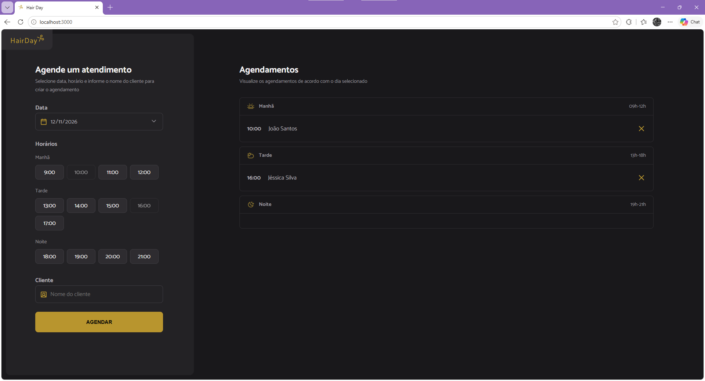

# HairDay 💇‍♀️

O HairDay é uma aplicação web voltada para o gerenciamento de uma barbearia ou salão de beleza. O sistema  permite visualizar e gerenciar os horários de atendimento (manhã, tarde e noite) de forma simples e intuitiva.

## 🚀 Como rodar localmente

Siga os passos abaixo para rodar o projeto na sua máquina. É necessário rodar o **Back-end** e o **Front-end** em terminais separados.

### 1. Clone o repositório
Abra o terminal e execute:
> git clone https://github.com/gabi-glo/HairDay.git
> cd HairDay

### 2. Instale as dependências e inicie os servidores
Execute o comando abaixo para instalar as dependências:
> npm install

Agora, inicie o **Back-end**:
> npm run server

Abra um **novo terminal** (na mesma pasta) e inicie o **Front-end**:
> npm run dev

> **Nota importante:** O Back-end rodará na porta **3333** (`http://localhost:3333`). O Front-end abrirá automaticamente na porta **3000** (`http://localhost:3000`). Mantenha os dois terminais abertos.

## 📸 Preview

## Funcionalidades
- Seleção de data
- Exibição de horários disponíveis por período (manhã, tarde e noite)
- Cadastro de agendamentos
- Cancelamento de agendamentos

## Créditos
Projeto baseado no Curso full stack - módulo de JavaScript da Rocketseat(https://www.rocketseat.com.br/).

## Autora
Gabriela Oliveira
https://github.com/gabi-glo

